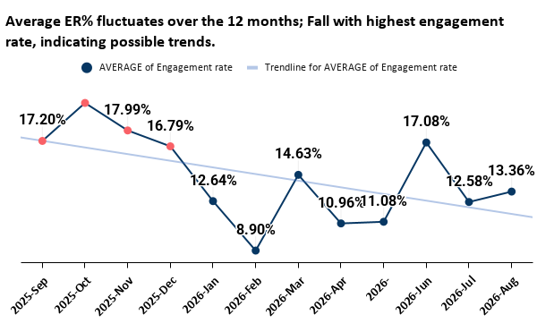
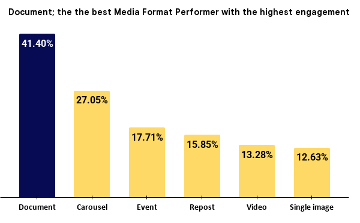
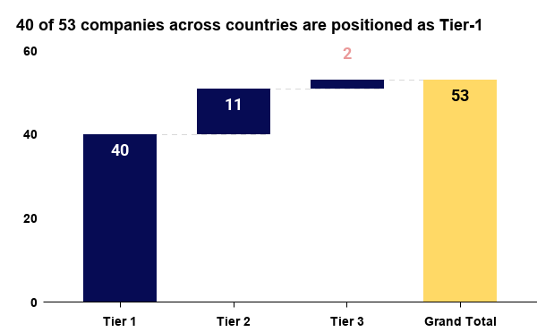
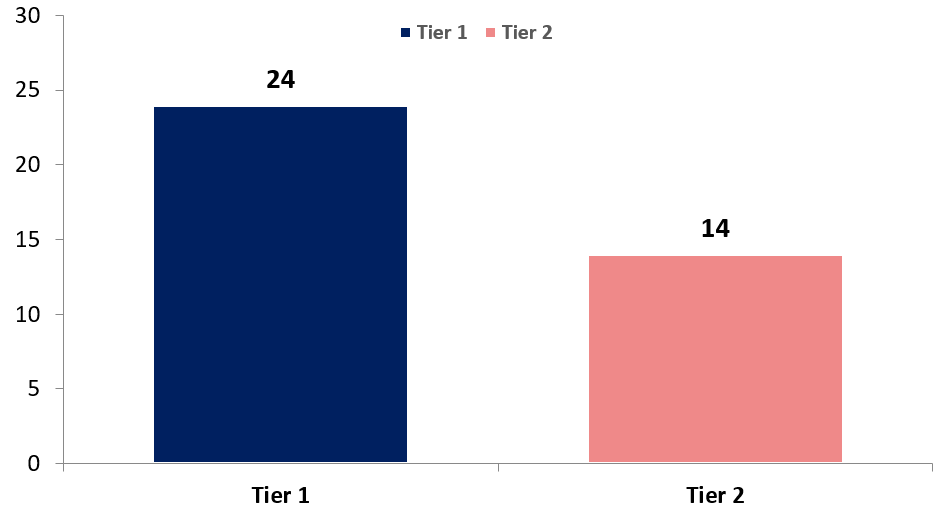
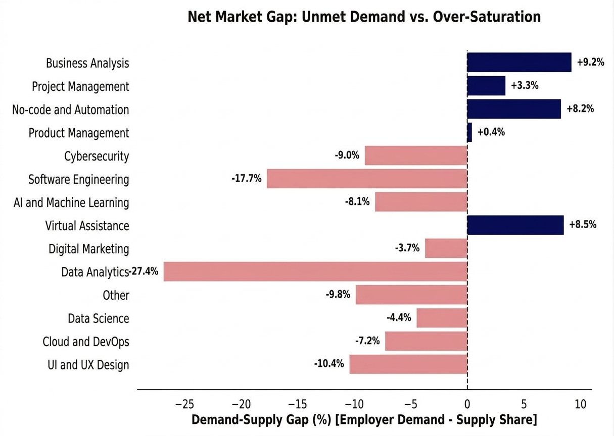
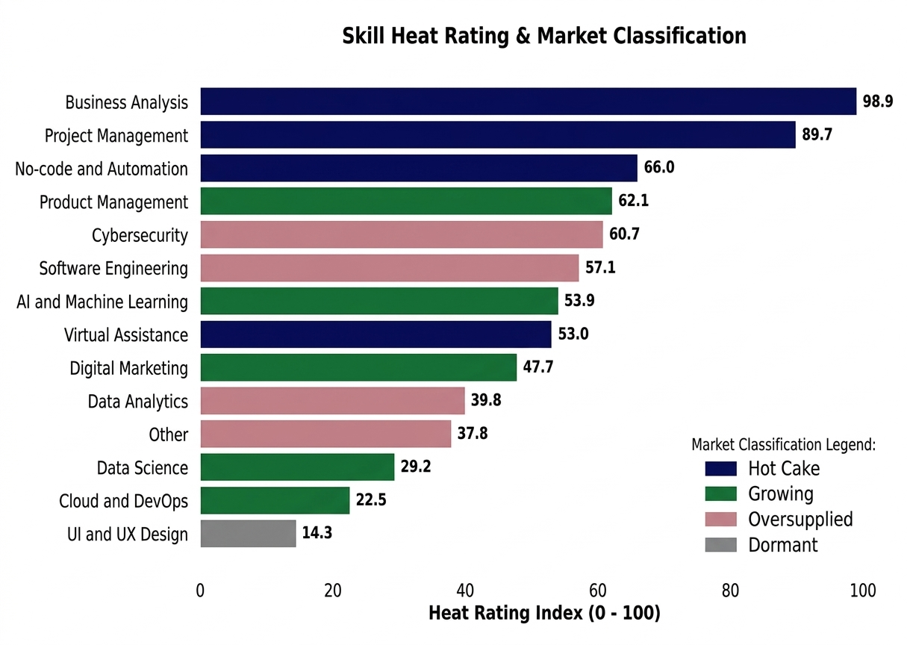

# Afriment B2B & Social Analytics Pipeline
**Role:** Data Analyst / Pod B Engineering Lead (Afriment Data Analytics Internship)

> [!CAUTION]
> **Note on Data Privacy:** In compliance with the Afriment internship NDA, all company names, contact emails, and absolute metrics in the sample CSV files have been fully fictionalized or anonymized. The schemas, scoring formulas, and validation rules remain identical to the production pipeline.

---

## Executive Summary & Key Impact
- **DATA INFRASTRUCTURE & QUALITY:** Standardized multi-source **data pipeline across 5 operational workstreams**, enforcing schema integrity and automated QA gates that eliminated downstream dashboard errors for Pod C analytics.
- **B2B PARTNERSHIP & MONETIZATION PIPELINE:** Architected a deterministic weighted-scoring model across **178 B2B entities, unlocking a qualified target pipeline of **40 Tier-1 companies, 38 high-fit communities, and 19 active funding sources** for talent absorption and sponsorship.
- **CONTENT & CURRICULUM STRATEGY OPTIMIZATION:** Diagnosed **12 months of social performance and market skill demands**, identifying a **high-performing Document/Student Testimonial** format and pinpointing an undersupplied course market gap **(Business Analytics, project management & AI Automation)** to drive a strategic curriculum pivot.

---

## 1. Business Context & Challenge
Afriment is a data analytics organization that bridges the gap between knowledge and experience by providing learners with real-world work portfolios. It operates a dual-model ecosystem: training tech talent and connecting verified portfolios with B2B employers and partners. 

Across 5 distinct workstreams (social posts, B2B company pipelines, foundation grants, course markets, and tech communities), raw inputs arrived unstructured, unvalidated, and prone to breaking downstream dashboards. 
Pod B served as the **Data Engine Room**, responsible for Validation, data cleaning, relational schema design, deterministic scoring rules, and metric validation.

---

## 2. System Architecture & Workflow

To make sure zero data corruption in working pods, we operated as following:

**Raw Inputs (Pod A / Exports) **-->** Pod B Engine (Clean, Standardize, Rule-Score) **-->** Outputs (Pod C Dashboards / SQL Models).**

- **The Source Rule:** Raw exports in `/00_Source_Data/` were treated as read-only. Nothing was ever edited directly in the source.
- **Quality Gates:** Every data batch underwent a mandatory 15-minute QA check to eliminate trailing spaces, enforce YYYY-MM-DD date formats, fix numbers stored as text, and eliminate duplicate entries.

---

## 3. Workstream Deep-Dives & Technical Execution

### Workstream 1: Social Media Performance Autopsy (305 Posts)

- **The Problem:** 12 months (2025-09-09 - 2026-8-31) of historical LinkedIn exports lacking standardized classifications such as **Media_Format** and **Content_Pillar** and Afriment wants to know which kind of its content performed the best.
- **The Execution:**
	- Created `04_Classification_Rules` to tag Media Formats and Content Pillars and classified all 306 posts through manual checking.
	- Built `02_Clean_Posts` to track metrics and utilized median engagement rates per 1,000 impressions to prevent viral anomalies from skewing performance baselines.
 - Analyzed performance across Media Formats and Content Pillars over 12 months of data.
- **The Output:** A validated and cleaned full-year dataset of 305 posts classified of media format and content pillar.

- **Visual Evidence:**

  

  

- **Key Finding:** **Document Student Testimonial/Career Advice** outperformed single image posts (current dominant posts), with Fall (Sep–Dec 2025) yielding the highest engagement rate window.
- **Recommendation:** Adopt a 4-week pilot reallocating content creation resources toward **Student Testimonial/Career Advice document** carousels and student testimonials.

---

### Workstream 2, 3 & 5: B2B & Foundation Scoring Pipelines
- **The Problem:** Which companies and communities are the best option for Afriment to partner, absorb sponsorships and secure community engagement? across
	- **53 companies** with operational gaps suitable for talent placement.
	- **60 foundations** capable of funding intern cohorts.
	- **63 communities** offering career guidance (non-competitor training models) fitting partnership criteria.
- **The Execution:** Designed a live weighted scoring model (`02_Scoring_Rules`) to rank companies and foundations based on online social presence, evidence of recent activity, active funding windows, grant sizes, and verified decision-maker channels.
- **The Output:** A verified pipeline of **40 Tier-1** companies and **38 confirmed** communities (Score >= 80) for potential partnership and **19 active/contactable foundations** that can be Afriment's interns potential sponsors.

- **Visual Evidence:**

  

  

    38 out of 63 Communities are pitch ready
  

  

- **Key Findings & Strategic Recommendations:**
	- **Finding:** Out of 176 entities investigated across companies, funds, and communities, 97 active targets were verified and qualified for immediate outreach.
	- **Recommendation:**
	   1. Offer free, value-driven joint events to the 38 qualified communities to organically funnel job seekers into the Afriment ecosystem.
    	2. Conduct targeted outreach to the 40 Tier-1 companies, positioning Afriment as a verified talent pipeline for specialized domain roles.
     	3. Engage the 19 active/contactable funds to formalize intern sponsorship structures.

---

### Workstream 4: Skills Market Intelligence Model

- **The Problem:** A market gap between tech academies course offerings and actual employer hiring demands across 6 African countries.
- **The Execution:**
	- Ingested employer job postings and academy course catalogs.
	- Modeled demand vs. supply metrics to compute skill heat ratings and categorized them into a 2x2 matrix (*Hot Cakes, The Gap, Oversupplied, Dormant*).
- **The Output:** Strategic adjustments recommendations identifying Data Analytics with the highest oversaturated course while the Business Analytics, Project Managements & No-Code/Automation have a high demand but less academies offering them (Hot Cake).

- **Visual Evidence:**

  

  

- **Key Findings & Strategic Recommendations:**
  - **Finding:** Traditional Data Analytics course supply vastly outpaces distinct regional employer demand spikes, whereas applied hybrid domains like Business Analytics and Automation represent open market opportunities.
  - **Recommendation:** Blend Data Analytics training modules with Business Analysis, Project Management, and No-Code/Automation tracks to differentiate graduates and maximize placement success.

---

## 4. Key Insights & Strategic Recommendations
- **Content Strategy:** Lunch a 4 week pilot project, increasing **Document and Student-Testimonial/Career Guide** content and validate before large samples.
- **Curriculum Pivot:** Consider **blending Data Analytics with Business Analysis, Project Management & No-code/Automation** to stand out in the market.
- **Ecosystem Outreach:** Execute outreach across **38 regional communities, 40 Tier-1 companies, and 19 active funds** spanning 6 countries by:
	- Hosting free, value-driven joint community events to drive organic user acquisition.
	- Positioning Afriment as a verified, high-quality talent engine for specialized enterprise domains.
